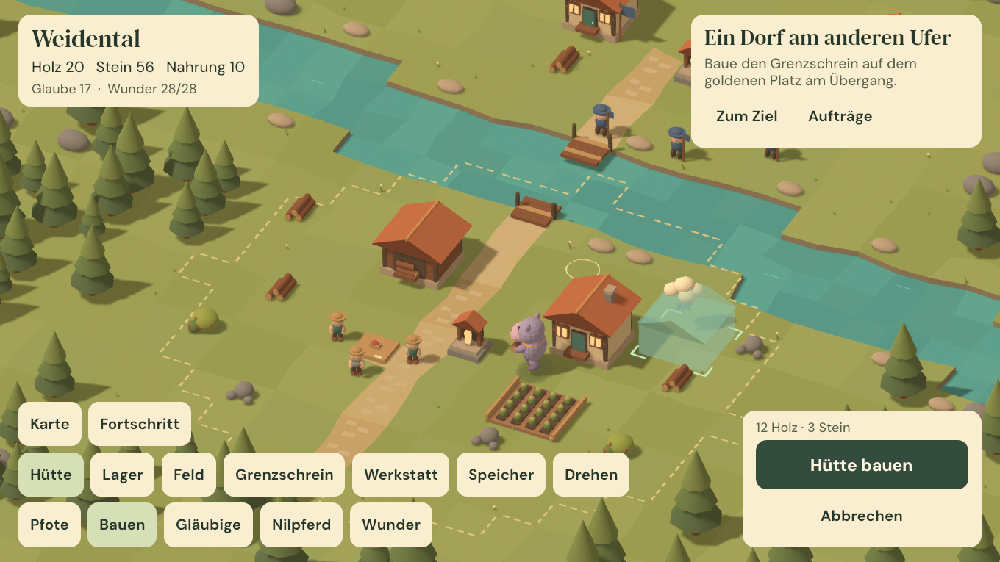

# Hippogrove

Ein mobiles Cozy-3D-Götterspiel in Rust und Bevy. Als junger Nilpferdgott hilfst du einem Dorf am Fluss, baust es aus und gewinnst Glauben. Deine Wolkenpfote greift direkt in die Welt ein. Ein aufrecht laufendes Nilpferd sammelt, trägt und lernt an deiner Seite.

Hippogrove spielt sich im Querformat per Touch oder mit angeschlossenem Controller. Der erste Spielstand enthält Weidental, Kiefernbucht, Reisterrassen und Papyrusufer. Je Kapitel baust du eine Siedlung auf, erweiterst ihren Einfluss und gewinnst die Nachbarn durch Versorgung und Ansehen oder vertreibst ihre Wachen. Talente und Kreaturenrang reisen mit. Die vier Siedlungen werden lokal gespeichert.



## Spielen

Auf Android öffnest du die signierte Test-APK aus deinen Downloads. Benötigt werden Android 8 oder neuer, ein 64-Bit-Gerät und Vulkan. [Android-Testversionen](https://github.com/bthginfo/Hippogrove/releases)

Tippe auf einen Holzstoß und bestätige **Greifen**. Wähle dann den Sammelplatz und **Ablegen**. Mit **Gläubige** und **Nilpferd** erteilst du Sammelaufträge. **Zum Ziel** zeigt einen passenden Zielpunkt für das aktive Werkzeug. In **Fortschritt** setzt du Talentpunkte ein und lobst das Nilpferd nach einer Lieferung.

| Steuerung | Kamera und Ziel | Aktionen |
| --- | --- | --- |
| Touch | Boden ziehen, mit zwei Fingern zoomen, Ziel antippen | Werkzeugleiste und Bestätigung |
| Controller | Linker Stick bewegt die Wolkenpfote, rechter Stick schwenkt, Trigger zoomen | Steuerkreuz wählt Werkzeuge oder Menüpunkte, Südtaste bestätigt, Osttaste bricht ab, Start öffnet die Karte |
| Rechner | Maus zum Antippen, Ziehen und Zoomen, WASD zum Schwenken | 1–5 für Werkzeuge, E für die Aktion, R zum Drehen, G fürs Ziel, Tab für die Karte, Q für Aufträge, P für Fortschritt, F12 für ein Spielbild |

## Projekt bauen

```sh
cargo run --locked
cargo test --locked --lib
```

Unter Linux braucht die Desktop-Entwicklung X11, Vulkan und `libudev-dev`. `HIPPOGROVE_SAVE_DIR` kann für einen getrennten Testspielstand auf ein anderes Verzeichnis zeigen.

### Android

Die Paketierung verwendet JDK 17 oder neuer, Python 3, Android SDK Platform 36, Build Tools 36.0.0 und NDK r28c. Setze `ANDROID_HOME` auf das SDK.

```sh
rustup target add aarch64-linux-android x86_64-linux-android
tools/build-android.sh
```

Die signierte Testdatei liegt unter `build/android/`. Für spätere Updates der Testversion wird derselbe Schlüssel aus `build/android/hippogrove-test.jks` verwendet.

### iOS und iPadOS

Das Paketierungsskript benötigt einen Mac mit Xcode. Auf Apple Silicon ist das Rust-Ziel `aarch64-apple-ios-sim` für den Simulator vorgesehen. Auf einem Intel-Mac ist es `x86_64-apple-ios`.

```sh
rustup target add aarch64-apple-ios-sim
tools/build-ios.sh
```

Ein Gerätebuild mit `HIPPOGROVE_IOS_DEVICE=1` verwendet `aarch64-apple-ios` und braucht für die Installation eine Apple-Entwicklungssignatur mit passendem Provisioning-Profil.

## Referenzen und Modelle

Black & White und Black & White 2 liefern die Spielideen für Hand, Einfluss, Kreatur und Siedlungsbau. Waldwinkel ist die Vorlage für die Low-Poly-Optik, die Bedienung und die mobile Paketierung. Der ausführliche Plan enthält weitere Spielreferenzen und die geprüften Skills. [Waldwinkel](https://github.com/bthginfo/waldwinkel) · [Entwicklungsplan](PLAN.md)

Die Blender-Quelle liegt in `art/Hippogrove.blend`. `blender -b -P art/build_scene.py` erzeugt das Nilpferd und seinen GLB-Export. In Bevy bewegen sich Arme und Beine über getrennte Drehpunkte. [Weidental](docs/weidental-referenz.png) · [Kiefernbucht](docs/kiefernbucht-referenz.png) · [Reisterrassen](docs/reisterrassen-referenz.png) · [Papyrusufer](docs/papyrusufer-referenz.png)

## Geprüfter Stand

Die Rust-Tests spielen den Friedensweg durch alle vier Kapitel und beide Ausgänge im Weidental. Sie prüfen Wegfindung am Übergang, einmalige Materialkosten, Fortsetzen mit einem gehaltenen Bündel und den Erhalt von Stadt und Talenten beim Kapitelwechsel.

Im laufenden Bevy-Spiel wurden Holztransport, Sammelaufträge, Bau, Regen, Ernte und Wiederladen geprüft. Die Spielkamera und Oberfläche wurden als 16:9-, 4:3- und breites Handyformat mit der Bildvorlage verglichen. Nach dem ersten Vergleich wurde das Licht weicher abgestimmt, die Kamera näher gesetzt und das Nilpferd vergrößert. [Konzeptbild](docs/weidental-referenz.png) · [Bevy-Spielaufnahme](docs/weidental-spiel.png)
