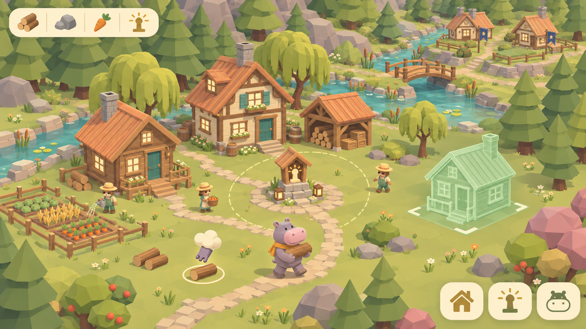

# Hippogrove

Ein mobiles Cozy-3D-Götterspiel in Rust und Bevy. Als junger Nilpferdgott hilfst du einem Dorf am Fluss, baust es aus und gewinnst Glauben. Deine Wolkenpfote greift direkt in die Welt ein. Ein aufrecht laufendes Nilpferd sammelt, trägt und lernt an deiner Seite.

Hippogrove ist für Handys und Tablets im Querformat geplant. Die ganze Kampagne soll per Touch oder mit angeschlossenem Controller spielbar sein. Black & White und Black & White 2 sind die spielerischen Vorbilder für Siedlungsbau, Wunder und eine lernende Kreatur. Waldwinkel liefert die Vorlage für die Low-Poly-Optik, die Bedienung und den Arbeitsablauf von Blender bis zum Gerätebuild. [Waldwinkel](https://github.com/bthginfo/waldwinkel)

Der Plan beschreibt den ersten spielbaren Abschnitt, die Kampagne und die Tests auf den Zielgeräten. [Entwicklungsplan](PLAN.md)
