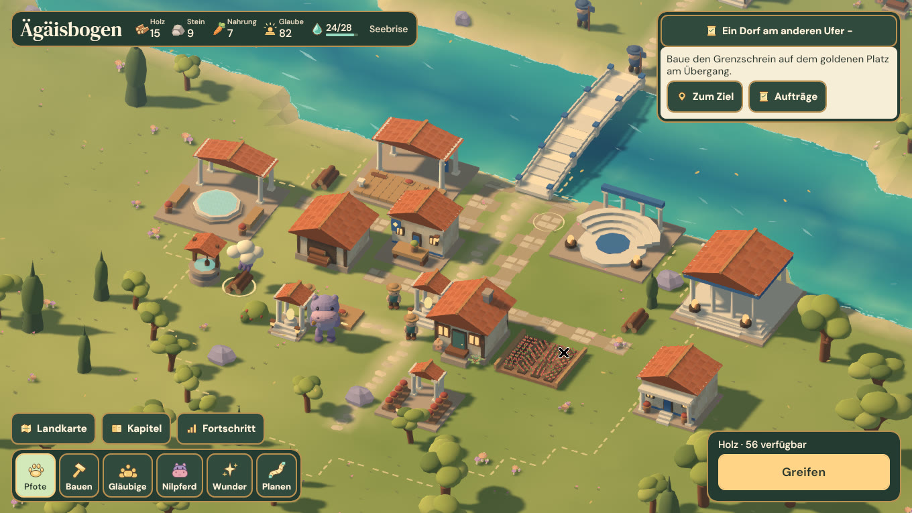

# Hippogrove

Ein mobiles Cozy-3D-Götterspiel in Rust und Bevy. Als junger Nilpferdgott hilfst du einem Dorf am Fluss, baust es aus und gewinnst Glauben. Deine Wolkenpfote greift direkt in die Welt ein. Ein aufrecht laufendes Nilpferd sammelt, trägt und lernt an deiner Seite.

Hippogrove 1.0 spielt sich im Querformat per Touch oder mit angeschlossenem Controller. Fünf Themenkampagnen haben je drei Kapitel. In Europa, im nordischen Fjord, auf ostasiatischen Terrassen, am afrikanisch inspirierten See und in der griechischen Ägäis stiftest du Bündnisse oder gewinnst Siedlungen mit Wundern und Wachen. Für jede Landschaft gibt es auch **Freies Bauen** mit offenen Brücken, allen Plänen und einem eigenen Spielstand. [Kampagnen und Sandbox](docs/V1.md#kampagnen-und-freies-bauen)



## Spielen

Auf Android öffnest du die signierte Test-APK aus deinen Downloads. Benötigt werden Android 8 oder neuer, ein 64-Bit-Gerät und Vulkan. [Hippogrove 1.0.0 für Android](https://github.com/bthginfo/Hippogrove/releases/tag/v1.0.0)

Wähle eine Kampagne. Eine Kamerafahrt mit Untertiteln führt dich zur ersten Quest. Tippe auf einen Holzstoß und bestätige **Greifen**. Wähle dann den Sammelplatz und **Ablegen**. Mit **Gläubige** und **Nilpferd** erteilst du Sammelaufträge. **Zum Ziel** zeigt einen passenden Zielpunkt für das aktive Werkzeug. In **Fortschritt** setzt du Talentpunkte ein. Das Nilpferd lernt durch Lob nach einer Lieferung, Wache oder Ernte.

Unter **Planen** zeichnest du Wege mit Anfang und Ende. Ausbauten brauchen eine Werkstatt und einen Anschluss an den Dorfweg. Das **Baubuch** zeigt 33 Gebäudearten pro Landschaft, darunter das automatisch öffnende Palisadentor und einen regionalen Bau. Insgesamt gibt es 37 Gebäudearten. Im **Forschungsmenü** erschließt du 12 Technologien über vier Zweige. Am Wegenetz können Familien wachsen, Betriebe Vorprodukte und Werkzeug herstellen, Treffpunkte die Stimmung heben und Wachhäuser Wachen ausbilden. Auf der **Landkarte** springst du zu Dörfern und Rohstoffgebieten. Dort baust du Sammellager, die Wege verkürzen und deiner Pfote den Abbau vor Ort erlauben. Unter **Vorräte** siehst du die Rohstoffe, Vorprodukte und das getragene Bündel als bebilderte Gegenstände.

Tippe auf den Titel des aktiven Auftrags, um ihn einzuklappen. Der goldene Knopf zeigt die Aktion für das ausgewählte Ziel. Im Nilpferd-Werkzeug findest du Lob, Snack und Pause unter **Pflege**. Der Fokusrahmen zeigt im Menü, welche Aktion du per Controller oder Tastatur bestätigst.

| Steuerung | Kamera und Ziel | Aktionen |
| --- | --- | --- |
| Touch | Boden ziehen, mit zwei Fingern schwenken und zoomen, Ziel antippen | Werkzeugleiste und Bestätigung |
| Controller | Linker Stick bewegt die Wolkenpfote, rechter Stick schwenkt, Trigger zoomen | Steuerkreuz wählt Werkzeuge oder Menüpunkte, Südtaste bestätigt, Osttaste bricht ab, Start öffnet die Karte. Die linke Schultertaste öffnet beim Bauen das Baubuch. |
| Rechner | Maus zum Antippen, Ziehen und Zoomen, WASD zum Schwenken | 1–6 für Werkzeuge, E für die Aktion, R zum Drehen, G fürs Ziel, M für die Landkarte, Tab für Kapitel, Q für Aufträge, P für Fortschritt, B fürs Baubuch und T für Forschung, I für Vorräte und F für Spielmodi. Pfeiltasten und Enter bedienen Menüs. F12 speichert ein Spielbild. |

## Projekt bauen

```sh
cargo run --locked
cargo test --locked --lib
```

Unter Linux braucht die Desktop-Entwicklung X11, Vulkan und `libudev-dev`. `HIPPOGROVE_SAVE_DIR` kann für einen getrennten Testspielstand auf ein anderes Verzeichnis zeigen.

### Android

Die Paketierung verwendet JDK 17 oder neuer, Python 3, Android SDK Platform 36, Build Tools 36.0.0 und NDK r28c. Setze `ANDROID_HOME` auf das SDK.

```sh
rustup target add aarch64-linux-android x86_64-linux-android
tools/build-android.sh
```

Die signierte Testdatei liegt unter `build/android/`. Für spätere Updates der Testversion wird derselbe Schlüssel aus `build/android/hippogrove-test.jks` verwendet.

### iOS und iPadOS

Das Paketierungsskript benötigt einen Mac mit Xcode. Auf Apple Silicon ist das Rust-Ziel `aarch64-apple-ios-sim` für den Simulator vorgesehen. Auf einem Intel-Mac ist es `x86_64-apple-ios`.

```sh
rustup target add aarch64-apple-ios-sim
tools/build-ios.sh
```

Ein Gerätebuild mit `HIPPOGROVE_IOS_DEVICE=1` verwendet `aarch64-apple-ios` und braucht für die Installation eine Apple-Entwicklungssignatur mit passendem Provisioning-Profil.

## Referenzen und Modelle

Black & White und Black & White 2 liefern die Spielideen für Hand, Einfluss, Kreatur und Siedlungsbau. Waldwinkel ist die Vorlage für die Low-Poly-Optik, die Bedienung und die mobile Paketierung. Der ausführliche Plan enthält weitere Spielreferenzen und die geprüften Skills. [Waldwinkel](https://github.com/bthginfo/waldwinkel) · [Entwicklungsplan](PLAN.md)

Die Blender-Quelle liegt in `art/Hippogrove.blend`. `blender -b -P art/build_scene.py` erzeugt das Nilpferd und seinen GLB-Export. In Bevy bewegen sich Arme und Beine über getrennte Drehpunkte. Für die neuen Gebäude entstanden eigene Low-Poly-Modelle und Materialien. Die Referenzen lagen vor dem Modellieren vor. [Modellquellen der Gebäude](src/art/settlement_models.rs) · [Gebäudestudie](docs/gebaeude-referenz.png) · [Ägäisbogen](docs/aegaeisbogen-referenz.png) · [Forschungsoberfläche](docs/forschung-referenz.png)

Die Karten reichen bis 178 × 140 Felder. Gebirgsketten, Täler, dichte Haine, Felsformationen und modellierte Küsten machen die Landschaft lesbar. Beim Sammeln kippen Bäume, Stein bricht in Splitter und Früchte lösen sich vom Strauch. Bevy stimmt Sonnenwinkel, Fülllicht, Dunst und Schatten auf die jeweilige Welt ab. Das Höhenprofil bestimmt gleichzeitig, wo Figuren laufen, wo Regen auftrifft und welchen Bodenpunkt die Wolkenpfote auswählt. Acht Vegetations-, Siedlungs- und Rohstoffmodelle stammen aus Waldwinkel 1.1.0. [Licht, Wetter und Herkunft der Modelle](docs/V1.md#gelände-licht-wetter-und-physik)

## Geprüfter Stand

Die Rust-Tests spielen den Friedensweg durch die 15 Themenkapitel sowie die fünf Kapitel der Chronik und den Kampfweg im Weidental. Sie prüfen auch die Forschungs- und Produktionsketten, Geburten, Patrouillen, Wunder, die Menüführung und die Übernahme älterer Spielstände. [Spielaufnahmen und Prüfungen für 1.0](docs/V1.md) · [Stadtentwicklung](docs/Stadtentwicklung.md)
