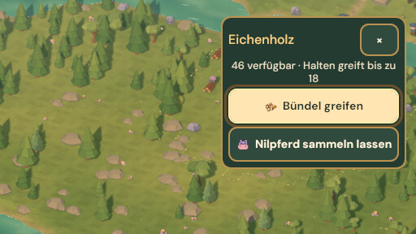
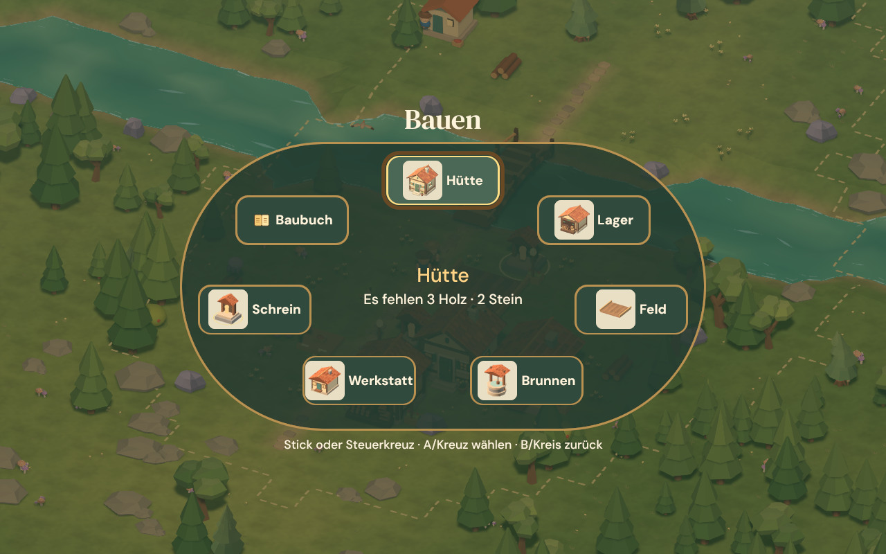
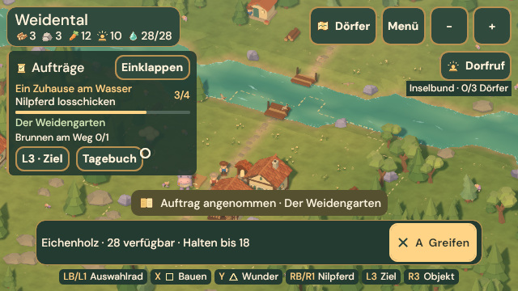
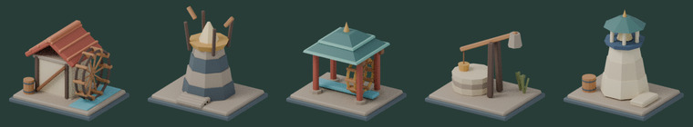
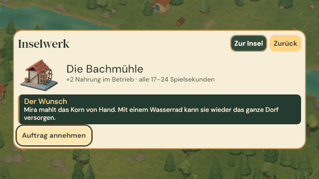
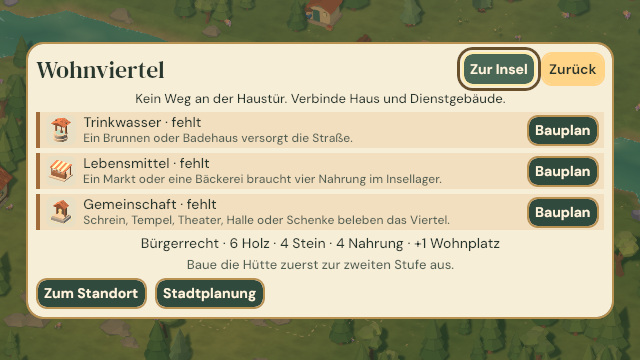
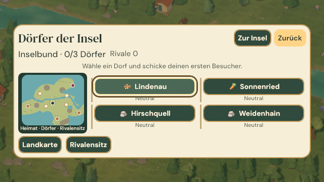
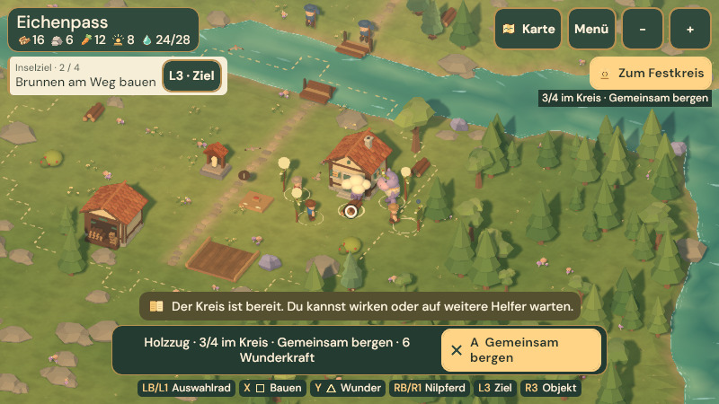
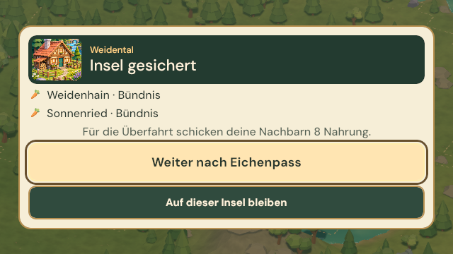

# Hippogrove

Ein mobiles Cozy-3D-Götterspiel in Rust und Bevy. Als junger Nilpferdgott hilfst du einem Dorf am Fluss, baust es aus und gewinnst Glauben. Deine Wolkenpfote greift direkt in die Welt ein. Ein aufrecht laufendes Nilpferd sammelt, trägt und lernt an deiner Seite.

**[Hippogrove 1.7.2 für Android herunterladen](https://raw.githubusercontent.com/bthginfo/Hippogrove/203398a82eef99e771ca7670a0f35fb7d4c642e6/Hippogrove-1.7.2.apk)** · [Release-Notizen](https://github.com/bthginfo/Hippogrove/releases/tag/v1.7.2) · [SHA-256](https://raw.githubusercontent.com/bthginfo/Hippogrove/203398a82eef99e771ca7670a0f35fb7d4c642e6/Hippogrove-1.7.2.apk.sha256)

Mit **1.7.2** kannst du im Hauptmenü unter **Spielstände** einzelne Kampagnen, freie Bauwelten, die Chronik und das Tutorial löschen. Die Bestätigung nennt den gewählten Spielstand. Am Controller ist **Abbrechen** vorgewählt. Nach dem Löschen des letzten Spielstands kannst du auf der Übungsinsel neu beginnen.

Seit **1.7.1** stellt sich die Anzeige auf dem Tablet auf deinen Controller ein. Schrift und Auswahlräder wachsen mit der nutzbaren Fläche. Unter **Anzeige** kannst du den Leseabstand selbst wählen.

Seit **1.7.0** baust du zusammen mit deinem Nilpferd ein Werk für die Insel. Im Weidental bittet Mira um eine Bachmühle. Du bringst das Holz, dein Nilpferd hebt das Rad in die Mühle und ein Feld am Dorfweg liefert den Anschluss. Bei der Einweihung entscheidest du, ob dein Nilpferd Erfahrung, deine Gottheit einen Talentpunkt oder dein Dorf die doppelte Leistung erhält.

Die signierte Standalone-App braucht Android 8 oder neuer und Vulkan. Die APK unterstützt ARM64 und x86_64. Die frühere Playtest-App und die Standalone-App haben eigene Spielstände.

Hippogrove spielt sich im Querformat per Touch oder mit angeschlossenem Controller. Fünf Themenkampagnen haben je drei Kapitel. In Europa, im nordischen Fjord, auf ostasiatischen Terrassen, am afrikanisch inspirierten See und in der griechischen Ägäis stiftest du Bündnisse oder gewinnst Siedlungen mit Wundern und Wachen. Für jede Landschaft gibt es auch **Freies Bauen** mit offenen Brücken, allen Plänen und einem eigenen Spielstand. [Kampagnen und Sandbox](docs/V1.md#kampagnen-und-freies-bauen)


## Spielen

Öffne die heruntergeladene APK auf deinem Android-Gerät und installiere sie. In der App-Übersicht findest du das Spiel unter **Hippogrove**. [Alle Veröffentlichungen](https://github.com/bthginfo/Hippogrove/releases)

Wähle im Hauptmenü **Tutorial**. Auf der Übungsinsel führen acht Etappen vom ersten Holzbündel bis zur Ernte und zur Pflege deines Nilpferds. Ein Marker bleibt an deinem Ziel. Du öffnest das Baurad, wählst selbst eine Hütte und bestätigst erst danach den Bau. Nach der Übung kannst du direkt ins Weidental reisen oder eine andere Kampagne wählen. Der erste Auftrag wartet, bis du **Zum ersten Ziel** wählst. Über **Menü → Hauptmenü** kannst du die Partie verlassen und später mit **Spiel fortsetzen** wieder einsteigen.

Tippe in der Welt auf ein Objekt oder drücke am Controller **R3**. Am Holzstoß kannst du ein Bündel greifen, dein Nilpferd losschicken oder einen freien Dorfbewohner einteilen. Ein fast volles Lager nimmt an, was hineinpasst. Der Rest bleibt in deiner Pfote. Halte direkt auf dem Holz oder auf **Greifen**, um bis zu 18 Einheiten zu nehmen. Ein trockenes Feld bietet Regen an, ein reifes Feld die Ernte. Bei einer Familie oder Hütte kannst du einmal pro Spieltag drei Nahrung teilen. Das bringt zwei Glauben und hebt die Stimmung des Dorfes für diesen Tag. Kosten und Erträge erscheinen am Ort der Aktion.



### Auf dem Tablet mit Controller spielen

Öffne im Hauptmenü **Anzeige** oder während des Spiels **Start → Spiel → Anzeige**. **Automatisch** nutzt auf größeren Bildschirmen mehr Platz für Schrift und Räder, sobald du den Controller verwendest. Für ein Tablet auf einem Ständer gibt es **Groß**. **Kompakt** lässt mehr Platz für die Insel. Die Wahl bleibt nach dem Beenden gespeichert.

Um eine Partie zu verlassen, drücke im Spiel **Start/Options**, dann **A/Kreuz** auf **Hauptmenü**. **Spiel fortsetzen** bringt dich zurück. Das funktioniert auch aus dem Baurad. Lieferungen und verfolgte Aufträge bleiben gespeichert.

Im Pausenmenü blättern **LB/L1** und **RB/R1** durch die drei Seiten. Im Spiel öffnen **X/Quadrat** das Baurad, **Y/Dreieck** die Wunder und **RB/R1** mit der freien Pfote die Kreatur. **L3** führt zum verfolgten Ziel, **R3** öffnet das Objektmenü. Der helle Innenrand mit dunkler Außenlinie zeigt, was **A/Kreuz** auslöst. Mit **B/Kreis** kehrst du zur vorherigen Auswahl zurück.



### Aufträge verfolgen und Rohstoffe erkennen

Im **Questtracker** stehen dein Inselauftrag, der nächste Schritt und die erfüllten Teilziele. Nimmst du im **Tagebuch** eine Dorfbitte an, erscheint sie mit ihrem eigenen Fortschritt darunter. **Zum Ziel** beziehungsweise **L3** führt zum Hauptziel. Für das Ziel der Dorfbitte öffnest du ihren Eintrag im Tagebuch. Hilferufe öffnen sich über die Schaltfläche neben der Restzeit. Du kannst den Tracker direkt einklappen oder mit dem Gamepad unter **Start → Spiel** umschalten. [Auftragsbuch im Spiel](docs/auftragsbuch.jpg)



Frei stehende Bäume und Felsblöcke auf der begehbaren Spielinsel geben Holz und Stein. Tippe auf Krone, Stamm oder Fels. Das Objektmenü zeigt Material und Restmenge. Im Einflussgebiet kann die Pfote bis zu 18 Einheiten auf einmal greifen. Außerhalb kannst du bei offenem Weg einen Sammler schicken. Das Gelände selbst und die Steine im Pflaster sind Landschaft. Abgeerntete Quellen verschwinden und erholen sich mit der Zeit.

### Ein Werk für deine Insel

Öffne **Menü → Inselwerk**, den Eintrag im Auftragsbuch oder den Sammelplatz mit leerer Pfote. Das Werkbuch zeigt das fertige Bauwerk, den Wunsch der Bewohner und die Wirkung auf dein Dorf. Nimm den Auftrag an, dann erscheinen die jeweils nötige Aktion und der Fortschritt im Tracker.

1. **Liefere aus dem Lager.** Im ersten Themenkapitel brauchst du sechs Einheiten, im zweiten neun und im dritten zwölf. Jeder Stapel zählt. Ist das Lager leer, führt dich **Material zeigen** zu einer nutzbaren Quelle.
2. **Baue mit deinem Nilpferd.** Rufe es zum Sammelplatz. Es legt eine getragene Ladung ab und läuft zum Bau. Sobald es angekommen ist, kannst du den Einsatz mit zwölf Kraft bestätigen. Es erhält einen Erfahrungspunkt. Auf dem Bauplatz steht jetzt das fertige Werk.
3. **Schließe den Betrieb an.** Im Werkbuch steht, welches Gebäude einen Weg braucht. Ein vorhandenes zählt. Fehlt es, führt **Anschluss vorbereiten** zum Bauplan oder seiner Voraussetzung. Für ein abseits stehendes Gebäude zeigt die Hilfe einen bezahlbaren Straßenabschnitt, wenn einer bis zum Gebäude reicht.
4. **Wähle die Widmung.** Vier zusätzliche Erfahrungspunkte für das Nilpferd, ein frei verteilbarer Talentpunkt oder doppelte Leistung für diese Stadt. Die Entscheidung bleibt mit der Insel gespeichert.

| Landschaft | Werk | Wirkung je Versorgungsrunde mit Anschluss |
| --- | --- | --- |
| Weidental | Bachmühle | 2 Nahrung |
| Nordischer Fjord | Wachtfeuer | Mindestens 8 Sekunden Schutz vor Überfällen |
| Ostasiatische Terrassen | Wasserpavillon | Mindestens 6 Sekunden Regen für wachsende Felder |
| See und Oase | Hebebrunnen | 4 Wunderkraft |
| Ägäis | Hafenlicht | 2 Stein |



Mit **L3** verfolgst du den nächsten Werkschritt. Über **Inselauftrag verfolgen** wechselst du zurück zum Hauptziel. Unter **Kreatur & Talente** siehst du die Erfahrung bis zum nächsten Wachstum und die Voraussetzung für die nächste Stadtstufe. In der **Zauberschule** kannst du jeden Rang ansehen. Erst **Rang lernen** gibt einen Punkt aus.



### Ein Wohnviertel planen

Öffne **Menü → Stadtplanung**. Du kannst ein bestehendes Haus ansehen oder am Zielpunkt einen Standort prüfen. Beim Platzieren einer Hütte öffnet **Versorgung** dieselbe Vorschau. Dienste erreichen Häuser über höchstens zwölf zusammenhängende Wegfelder. Eine Lücke in der Straße unterbricht die Versorgung.

| Bedürfnis | Gebäude und Voraussetzung |
| --- | --- |
| Trinkwasser | Brunnen oder Badehaus am verbundenen Weg |
| Lebensmittel | Markt oder Bäckerei am Weg und mindestens vier Nahrung im Insellager |
| Gemeinschaft | Schrein, Tempel, Theater, Halle oder Schenke am Weg |



**Bauplan** öffnet ein passendes Gebäude. **Zeigen** führt zum bestehenden Dienstgebäude. Eine ausgebaute Hütte mit allen drei Leistungen kann für sechs Holz, vier Stein und vier Nahrung das **Bürgerrecht** erhalten. Das schafft einen Wohnplatz. Ein vollständig versorgtes Bürgerhaus verbraucht anschließend je Versorgungsrunde eine Nahrung und bringt zwei Glauben. Knappheit oder eine unterbrochene Straße setzen diese Einnahme aus. Im freien Bauen ist das Verleihen des Bürgerrechts kostenlos.

### Um die Nachbardörfer spielen

Öffne **Dörfer** und wähle ein neutrales Dorf. Am Controller erreichst du die Übersicht mit **RB/R1 → Dörfer**, wenn die Hand aktiv ist, oder über **Start → Nachbardörfer**. Die Karte zeigt deine Heimat, die Dorfplätze und den Sitz des Rivalen. Im ersten, zweiten und dritten Kapitel jeder Themenkampagne beginnen vier, fünf und sechs Dörfer neutral.



- **Besuchen.** Schicke dein Nilpferd, einen Gläubigen oder beide. Sie können die Furten vor der Brückenreparatur überqueren. Am Platz gewinnt dein Nilpferd pro Spielsekunde fünf Vertrauen, ein Gläubiger dreieinhalb. Ein gegnerischer Gesandter gewinnt dort vier für seine Seite. Du kannst beide Besucher zusammen einsetzen oder zwei Dörfer gleichzeitig umwerben.
- **Helfen.** Ein Hilferuf bleibt 100 Spielsekunden offen. Über **Zum Hilferuf** siehst du, wer vor Ort gebraucht wird und was der Einsatz kostet. Im Weidental kann dein Nilpferd etwa für 18 Kraft Familien vor dem Hochwasser retten. Ein Gläubiger kann stattdessen vier Einheiten des angezeigten Materials einsetzen. Beide Wege bringen vier Glauben. Die Rettung mit der Kreatur bringt bis zu 55 Vertrauen, die Hilfe durch einen Gläubigen bis zu 35 und halbiert den Einfluss des Gesandten für 60 Sekunden.
- **Pilger empfangen.** Wähle ein fremdes oder neutrales Dorf und öffne **Pilgerzüge**. Ein eigenes Dorf mit mindestens 50 Prozent Bindung kann den Zug entsenden. Es gibt 20 Bindung ab und braucht danach 55 Sekunden Ruhe. Vier Nahrung finanzieren den Weg. Die Ankunft bringt bis zu 30 Vertrauen. Empfängt dein Nilpferd oder ein Gläubiger die Pilger am Ziel, sind es bis zu 55.
- **Gebiet gewinnen und halten.** Bei 100 Vertrauen schließt sich das Dorf deiner Seite an. Du kannst in seiner Umgebung bauen und bekommst bei freiem Lagerplatz alle 40 Spielsekunden zwei Einheiten seiner Ware. Sinkt die Bindung auf null, wird es wieder neutral. Hast du die Mehrheit, kannst du selbst **Inselbund schließen** wählen und das nächste Kapitel freischalten. Hält der Rivale die Mehrheit 75 Sekunden, fordert er bei Lieferungen bis zu zwei Einheiten Tribut. Sobald du ihm die Mehrheit nimmst, endet der Tribut.

### Mit dem Dorf spielen

Wähle auf einer Kampagneninsel oder im freien Bauen **Dorfruf**. Am Gamepad findest du ihn im Wunderrad unter **Y / Dreieck**. Das Spiel zeigt den Treffpunkt. Die Bewohner unterbrechen ihre Arbeit und gehen selbst dorthin. Jede leuchtende Laterne steht für jemanden, der angekommen ist. Geh währenddessen bauen oder erkunde die Insel. **Zum Festkreis** bringt dich zurück.

Sobald dein Nilpferd und ein Dorfbewohner am Platz sind, kannst du für sechs Wunderkraft handeln. Jeder weitere Teilnehmer verstärkt die Wirkung. Beim **Holzzug** oder **Steinzug** birgt die Gruppe je Person bis zu drei Einheiten aus der gewählten Quelle. Beim **Erntetanz** bringt jeder anwesende Dorfbewohner ein Feld in der Umgebung ein. Ein **Inselrat** schützt das Dorf. Bei einem unentschiedenen Nachbardorf können drei Teilnehmer sein Vertrauen gewinnen. Gib ihm dann die Dorfgabe, um das Bündnis zu schließen. Ein Machtruf senkt den Widerstand und kostet Stimmung. Nach einem erfolgreichen Ruf erholt sich das Dorf 36 Spielsekunden. Du kannst einen laufenden Ruf kostenlos auflösen.



Nach einem Kapitelabschluss bringt dich **Handeln** zu einem verfügbaren Angebot. **Reisebuch** öffnet die Inselbilanz und die Weiterreise. Öffne nach dem Beitritt eines Nachbardorfs die **Karte** und wähle seinen Namen. Dort siehst du den Tauschkurs. Am Dorf kannst du das Geschäft mit der Pfote oder im Objektmenü abschließen. Ein Verbündeter liefert acht Waren für vier, ein eroberter Ort fünf für vier. In einem eroberten Ort kannst du die fünf Waren als Tribut nehmen. Das kostet sechs Stimmung und prägt den Ruf deiner Stadt. Pro Ort ist ein Geschäft am Spieltag möglich. Die **Dorfchronik** im Spielmenü hält die letzten fünf Ereignisse fest.

Im Hauptmenü erreichst du unter **Ton** den **Testton** und kannst Musik, Umgebung und Effekte einzeln schalten oder gemeinsam einschalten. Der Testton nutzt die Medienlautstärke deines Geräts.

In einem neuen Weidental entscheidet die erste Holzladung, wem du zuerst hilfst. Mira nutzt sechs Holz für das erste Dach im Dorf. Jora repariert damit ihren Hof am anderen Ufer und schickt Stein und Nahrung zurück. Mit einem Bündel in der Pfote leuchten die Ablageplätze, an denen du es abgeben kannst.

Das **Baubuch** zeigt zu jedem Bauplan das Gebäude in seinem Landschaftsstil, seinen Zweck und die benötigten Rohstoffe. Es gibt 33 Gebäudearten pro Landschaft und 37 insgesamt. Wähle einen Bauplan, um den Grundriss in der Welt zu sehen. Die Vorschau zeigt, ob der Bauplatz frei ist oder was noch fehlt. **Freier Platz** sucht eine Fläche in der Nähe. Erst **Bauen** verbraucht Material.

Wähle ein errichtetes Gebäude oder öffne **Wege → Ausbau**, um Stufe 2 anzusehen. Das Fenster zeigt den Nutzen, den Materialpreis und die nötigen Gläubigen und den Glauben. In Kampagnen brauchst du zusätzlich eine Werkstatt und einen Dorfweg zum Gebäude. Glauben wächst unter anderem mit neuen Gebäuden, Ernten und erfüllten Aufträgen. Wunder verbrauchen Wunderkraft, die sich wieder auflädt. Beide Werte stehen auch unter **Vorräte**.

Unter **Wege** zeichnest du Wege mit Anfang und Ende. Im **Forschungsmenü** erschließt du zwölf Technologien über vier Zweige. Am Wegenetz können Familien wachsen, Betriebe Vorprodukte und Werkzeug herstellen, Treffpunkte die Stimmung heben und Wachhäuser Wachen ausbilden. Auf der **Landkarte** springst du zu Dörfern und Rohstoffgebieten und baust Sammellager.

Wähle auf der **Landkarte** ein Rohstoffgebiet, um seine drei Vorkommen zu vergleichen. Mit einem Sammellager kannst du dort Gläubige und das Nilpferd beauftragen. Sie wechseln zu einer anderen erreichbaren Quelle, wenn die erste leer ist. **Zur Quelle** richtet die Kamera für den Abbau von Hand aus. Mit einer Ladung in der Pfote markiert das Spiel die passende Ablage. [Sammelaufträge und Bildvorlage](docs/Sammelauftraege.md)

Die fünf Kampagnen haben je drei Inselkarten mit eigenen Küsten, Höhenzügen, Übergängen und Startplätzen. Im Weidenland ziehen sich Waldarme um die Mühlen. Der Fjord hat lang gestreckte Landzungen, die Terrassen große Bewässerungsbecken, das Seeufer Sandbuchten und die Ägäis vorgelagerte Felsinseln. Neue Spielstände und erstmals betretene Kapitel nutzen diese Landschaften. Beim Fortsetzen lädt jedes schon besuchte Kapitel die Karte seines Spielstands.

Das Nilpferd wächst durch Lieferungen, Ernten und erfolgreiche Wachen. Wähle es mit der Pfote, um es zu streicheln. Lobe es nach einer Lieferung von Holz, Stein oder Nahrung. Jeden Rohstoff lernt es einzeln. Sobald es frei ist und ein erlernter Vorrat auf acht Einheiten oder weniger fällt, holt es selbst Nachschub. Es versorgt zuerst den knappsten erreichbaren Rohstoff. **Pause** unterbricht die Hilfe. **Sammeln** oder ein neues Lob setzt sie fort. Unter **Fortschritt** siehst du seine nächste Wachstumsstufe. Hilfe und Bündnisse bringen der Stadt mehr Glauben und Stimmung. Einschüchterung stärkt den Schutz durch Wachtürme und kostet Stimmung. Stadt und Kreatur zeigen ihre Ausrichtung auch im Spielbild.

Auf den neuen Inseln bringen Rivale und Kreatur eine eigene Bedrohung mit. Ivens Mooshirsch beansprucht Holz, Sigruns Runenwolf bringt Frost, Lins Wolkendrache verzögert die Ernte, Nurus Schilfschlange vertreibt Sammler und Nereas Windgreif zerstreut Wunderkraft. Die Aufträge zeigen den nächsten Angriff und mögliche Gegenmaßnahmen. Du kannst die Nachbarn mit einem Bündnis gewinnen oder ihre Wachen und Kreatur mit Wundern zurückdrängen.

Nach dem Bau des Grenzschreins kannst du passende Bündel **direkt zur Brücke** tragen. Später nimmt das Dorf dort auch seine Gabe entgegen. Teillieferungen bleiben beim Speichern erhalten. Am Übergang kannst du die offene Menge aus dem Lager bezahlen. Unter **Aufträge** führen **Bündnis vorbereiten** und **Wachen anvisieren** zu den beiden Wegen durch den Konflikt.

Bei einem Nachbardorf führt die Zielführung zum Bauplatz am örtlichen Weg, zum Ausbau oder zur fehlenden Gabe. Am Ende siehst du beide Dörfer und ihre Entscheidung. Zur ersten Landung auf der nächsten Insel kommen je verbündetem Dorf vier Nahrung und je Dorf mit vertriebenen Wachen vier Stein mit. Du kannst auch bleiben und weiterbauen.



Jedes Kapitel hat eigene Bitten und einen Nebenauftrag. Im Weidenland versorgst du Mühlen und Höfe, im Fjord sicherst du Winterquartiere und auf den Terrassen bringst du mehrere Reisernten ein. Am See verbinden neue Wege die Brunnen und Märkte. In der Ägäis produzierst du Öl und richtest ein Theater für das Fest der Winde ein. Das Auftragsfenster zeigt den Fortschritt jedes Ziels. Bei Straßenaufträgen zeigt die Führung einen angeschlossenen Weg zur Bestätigung. Für regionale Baupläne öffnet sie die erforderliche Forschung. Wähle Sägewerk, Steinhof, Schmiede oder Olivenpresse direkt an, um die nächste Schicht vorzuziehen. Das Objektmenü zeigt Einsatz und Ertrag, der Betrieb arbeitet danach automatisch weiter. Schon besuchte Kapitel aus älteren Spielständen behalten ihre Aufträge.

Tippe beim Inselziel auf **Ziel zeigen** oder drücke **L3**, um Ort und Werkzeug für den aktuellen Auftrag zu finden. Unter **Menü → Aufträge** stehen die Aufgaben, ihr Fortschritt und die Bitten aus dem Dorf. Ein `!` auf der Karte kennzeichnet einen verfügbaren Nebenauftrag, ein `?` eine abholbare Belohnung. Der goldene Knopf zeigt die Aktion am ausgewählten Ziel. **Nilpferd** öffnet die Befehle zum Sammeln, Herbeirufen und zur Pflege. Das **Zauberbuch** zeigt die Voraussetzungen für Wunder. Der Fokusrahmen zeigt im Menü, welche Aktion du per Controller oder Tastatur bestätigst.

| Steuerung | Kamera und Ziel | Aktionen |
| --- | --- | --- |
| Touch | Boden ziehen, mit zwei Fingern schwenken, mit der Geste oder **+** und **−** zoomen, Ziel antippen | Objekt für sein Kontextmenü antippen, Quelle zum Greifen halten, **Aktionen** für das Auswahlrad |
| Controller | Linker Stick bewegt den Zielpunkt, rechter Stick schwenkt, Trigger zoomen | **LB/L1** öffnet das Auswahlrad, **X/Quadrat** das Baurad, **Y/Dreieck** das Wunderrad und **RB/R1** mit der Hand das Nilpferdrad. Stick oder Steuerkreuz wählen, **A/Kreuz** bestätigt, **B/Kreis** geht zurück. Beim Platzieren versetzt das Steuerkreuz den Plan feldweise, **X/Quadrat** dreht und **RB/R1** sucht einen freien Platz. **L3** zeigt das Auftragsziel auch beim Bauen. **R3** öffnet das Objektmenü. **Start** öffnet das Spielmenü. **Select/Options** öffnet die Landkarte. |
| Rechner | Maus zum Antippen und Ziehen, Mausrad oder **+** und **−** zum Zoomen, WASD zum Schwenken | Leertaste fürs Auswahlrad, 1–6 für Werkzeuge, E für die Aktion oder zum Halten beim Greifen, R zum Drehen, G für das Auftragsziel, H für das Werkzeugziel, M für die Landkarte, Tab für Kapitel, Q für Aufträge, P für Fortschritt, B fürs Baubuch und T für Forschung, I für Vorräte und F fürs Hauptmenü. Pfeiltasten und Enter bedienen Menüs. F12 speichert ein Spielbild. |

Das Spiel blendet die passenden Tasten an den Werkzeugen und bei der Bauvorschau ein. Die Übersicht steht im Spielmenü unter **Steuerung**.

## Projekt bauen

```sh
cargo run --locked
cargo test --locked --lib
```

Unter Linux braucht die Desktop-Entwicklung X11, Vulkan, `libudev-dev` und `libasound2-dev`. `HIPPOGROVE_SAVE_DIR` kann für einen getrennten Testspielstand auf ein anderes Verzeichnis zeigen.

### Android

Die Paketierung verwendet JDK 17 oder neuer, Python 3, Android SDK Platform 36, Build Tools 36.0.0 und NDK r28c. Setze `ANDROID_HOME` auf das SDK.

```sh
rustup target add aarch64-linux-android x86_64-linux-android
tools/build-android.sh
```

Ein Entwicklungsbuild liegt unter `build/android/`. Für die Standalone-APK setze `HIPPOGROVE_STANDALONE=1`, `HIPPOGROVE_KEYSTORE` und `HIPPOGROVE_KEY_PASSWORD_FILE`. Der Schlüsselalias ist standardmäßig `hippogrove` und lässt sich mit `HIPPOGROVE_KEY_ALIAS` setzen. Die signierte APK landet unter `build/android/standalone/`. Updates der Standalone-App verwenden die Paket-ID `game.hippogrove.standalone` und dieselbe Signatur.

### iOS und iPadOS

Das Paketierungsskript benötigt einen Mac mit Xcode. Auf Apple Silicon ist das Rust-Ziel `aarch64-apple-ios-sim` für den Simulator vorgesehen. Auf einem Intel-Mac ist es `x86_64-apple-ios`.

```sh
rustup target add aarch64-apple-ios-sim
tools/build-ios.sh
```

Ein Gerätebuild mit `HIPPOGROVE_IOS_DEVICE=1` verwendet `aarch64-apple-ios` und braucht für die Installation eine Apple-Entwicklungssignatur mit passendem Provisioning-Profil.

## Referenzen und Modelle

Black & White und Black & White 2 liefern die Spielideen für Hand, Einfluss, Kreatur und Siedlungsbau. Waldwinkel ist die Vorlage für die Low-Poly-Optik, die Bedienung und die mobile Paketierung. Der ausführliche Plan enthält weitere Spielreferenzen und die geprüften Skills. [Waldwinkel](https://github.com/bthginfo/waldwinkel) · [Entwicklungsplan](PLAN.md)

Die Blender-Quelle liegt in `art/Hippogrove.blend`. `blender -b -P art/build_scene.py` erzeugt das Nilpferd und seinen GLB-Export. In Bevy bewegen sich Arme und Beine über getrennte Drehpunkte. Für die neuen Gebäude entstanden eigene Low-Poly-Modelle und Materialien. Die Referenzen lagen vor dem Modellieren vor. [Modellquellen der Gebäude](src/art/settlement_models.rs) · [Gebäudestudie](docs/gebaeude-referenz.png) · [Ägäisbogen](docs/aegaeisbogen-referenz.png) · [Forschungsoberfläche](docs/forschung-referenz.png)

`blender -b -P art/build_villages.py` erzeugt die Hütten und Lager aller fünf Welten. Jedes der Gebäude ist ein einzelnes Mesh mit eingearbeiteten Farben und Reliefdetails. [Blender-Quelle für die Dörfer](art/build_villages.py)

Die Karten reichen bis 178 × 140 Felder. Gebirgsketten, Täler, dichte Haine, Felsformationen und modellierte Küsten machen die Landschaft lesbar. Beim Sammeln kippen Bäume, Stein bricht in Splitter und Früchte lösen sich vom Strauch. Bevy stimmt Sonnenwinkel, Fülllicht, Dunst und Schatten auf die jeweilige Welt ab. Das Höhenprofil bestimmt gleichzeitig, wo Figuren laufen, wo Regen auftrifft und welchen Bodenpunkt die Wolkenpfote auswählt. Acht Vegetations-, Siedlungs- und Rohstoffmodelle stammen aus Waldwinkel 1.1.0. [Licht, Wetter und Herkunft der Modelle](docs/V1.md#gelände-licht-wetter-und-physik)

Die Hafenlaterne, der Wachfarn und die Umgebungs- und Aktionstöne stammen aus Waldwinkel 1.5. Die sechs Originalstücke umfassen „Die kleine Bucht“ für Titel und Tutorial sowie je eine eigene Besetzung und Bearbeitung für die fünf Landschaften. Beim Inselwechsel blendet die Musik über. Zum Rendern nutzt `art/build_music.py` FluidSynth, NumPy, pyFluidSynth, FFmpeg und die Instrumente von GeneralUser GS 2.0.3. Musik, Umgebung und Effekte lassen sich im Spielmenü unter **Ton** einzeln schalten. [Waldwinkel 1.5](https://github.com/bthginfo/waldwinkel/tree/8a98a76a2921690b533015e3f57fadccc2c66b24) · [Instrumentenbank und Lizenz](https://github.com/mrbumpy409/GeneralUser-GS/blob/684543d5e5efaef08d02be50dcda8d552478fa60/documentation/LICENSE.txt)

## Geprüfter Stand

Für **1.7.2** bestanden 62 Rust-Tests. Im gerenderten Tablet-Menü wurden acht Spielstände über zwei Seiten per Controller verwaltet. Der Test hat Abbrechen, die Einzellöschung, die Rückkehr von der letzten Listenseite und den Neustart des Tutorials nach Löschen des letzten Spielstands geprüft. Auf Android 15 ließ sich die Auswahl mit A abbrechen. Nach erneutem Antippen reichten einmal rechts und A zum Löschen. Der Tutorial-Spielstand blieb erhalten.

Für **1.7.1** bestanden 60 Rust-Tests. Im gerenderten Spiel wurden die Controllerwege bei 1280 × 800 geprüft. Bei 2560 × 1600 mit zweifacher Pixeldichte lagen die Schaltflächen des Baurads auf denselben logischen Positionen. Die komplette R3-Beschriftung lag bei beiden Tablet-Auflösungen und bei 512 × 288 innerhalb des Bildes. Vor und nach Ablauf der Auftragsbestätigung lagen alle vier Ecken der Liefertaste auf denselben Pixeln.

Auf der Insel und im offenen Baurad führte **Start → A** ins Hauptmenü. Nach **Spiel fortsetzen** waren der aktive Auftrag, die drei gelieferten Holz und der Lagerbestand erhalten. Das Update von 1.7.0 auf 1.7.1 wurde auf Android 15 installiert. Dabei blieb die vorhandene Speicherdatei bytegleich. Ein Test auf einem physischen Galaxy Tab S9 FE+ steht aus.

In Version 1.7.0 bestehen 59 Rust-Tests. Die zusätzlichen Prüfungen decken die Inselwerke aller 15 Themenkapitel ab, einschließlich Teillieferungen, Ankunft des Nilpferds, Weganschluss und einmaliger Widmung. Auch die Übernahme eines Spielstands ohne Werk und ohne Bauerfahrung wird geprüft.

In einem frischen Spielstand führte die Übungsinsel vom ersten Griff bis zur Pflege des Nilpferds. Bau- und Wunderrad, Abbrechen und Fortsetzen mit einem Bündel in der Pfote funktionierten am virtuellen Gamepad. In der ersten Kampagne ließ sich Joras Hof beliefern und ein Lager bauen.

Im gerenderten Weidental ließ sich die Mühle mit virtuellem Gamepad vollständig vom Tagebuch bis zur ersten Versorgungsrunde spielen. Der dort verdiente Talentpunkt schaltete einen größeren Regenkreis frei. Bei 512 × 288 Pixeln führte **Material zeigen** nach einer Teillieferung zum Holz. Beim Wechsel zurück zum Inselauftrag blieb das gelieferte Holz am Bau. Für die Sichtprüfung standen zusätzlich alle fünf fertigen Werke in vorbereiteten Spielständen auf ihrer jeweiligen Insel.

Die APK ist für ARM64 und x86_64 gebaut, auf 16-KiB-Ausrichtung geprüft und mit demselben Zertifikat wie 1.6.0 signiert. Ein Spieltest auf einem physischen Galaxy Tab S9 FE+ steht aus.

### Frühere Spieltests

Für Version 1.6.0 bestanden 55 Rust-Tests. In allen 15 Themenkapiteln wurden die Entfernung der Startsitze und die erreichbaren Wege zu jedem Nachbardorf vor dem Brückenbau geprüft. Weitere Tests spielen Rückeroberung, Inselbund, Tribut, beide Hilfswege sowie einen gespeicherten Pilgerzug mit und ohne persönlichen Empfang durch.

Im gerenderten Spiel mit virtuellem Gamepad besuchten Nilpferd und Gläubiger Lindenau. Der Rivale gewann währenddessen Hirschquell. In einem weiteren Durchlauf rettete das Nilpferd Familien beim Hochwasser. Anschließend empfing es den Pilgerzug aus Lindenau in Weidenhain und gewann dort 55 Vertrauen. Der Questtracker zeigte nach der Annahme der Dorfbitte den fehlenden Brunnen am Weg. Die Stadtplanung führte vom ersten Haus zu den passenden Bauplänen.

Auf dem Android-15-Emulator wurde die signierte APK über die Standalone-Version 1.5.0 installiert. Die bestehende Speicherdatei blieb beim Update bytegleich. Ein älteres Weidental ließ sich fortsetzen. Ein Vorher-nachher-Vergleich desselben Dorfrats zeigt, dass die Abdunklung jetzt auch den unteren Android-Gestenbereich erreicht. Tagebuch und Wohnviertel ließen sich im gerenderten Spiel bei 640 × 360 und 512 × 288 Pixeln mit virtuellem Controller bedienen. Ein Test auf einem physischen Galaxy Tab S9 FE+ mit angeschlossenem Controller steht aus.

Die Rust-Tests spielen den Friedensweg durch die 15 Themenkapitel sowie die fünf Kapitel der Chronik und den Kampfweg im Weidental. Sie prüfen auch die Forschungs- und Produktionsketten, Geburten, Patrouillen, Wunder, die Menüführung und die Übernahme älterer Spielstände. [Spielaufnahmen und Prüfungen für 1.0](docs/V1.md) · [Stadtentwicklung](docs/Stadtentwicklung.md)
