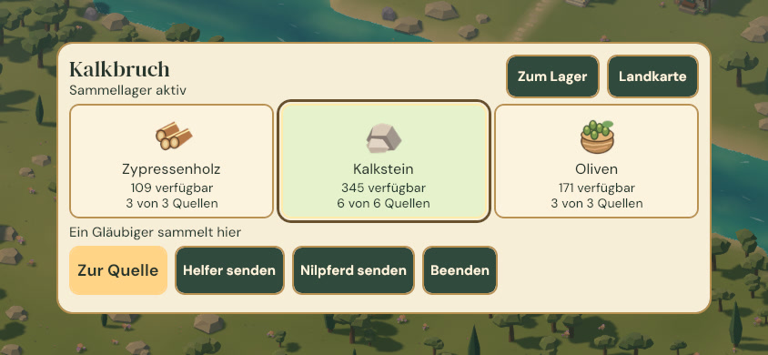

# Sammelaufträge in Hippogrove 1.1

Öffne die **Landkarte** und wähle eines der drei Rohstoffgebiete. Die Karten zeigen den aktuellen Vorrat und die Zahl der gefüllten Quellen für jedes der drei Materialien. **Zur Quelle** springt zum nächsten Vorkommen des ausgewählten Materials und bevorzugt gefüllte Quellen. **Zum Lager** springt zum Sammelplatz des Gebiets.

Nach der Brückenreparatur kostet ein Sammellager fünf Holz und sechs Glauben. In **Freies Bauen** sind die Lager von Anfang an offen. Wähle ein Material und sende einen freien Gläubigen oder das Nilpferd. Ist eine Quelle leer, suchen sie im Gebiet eine erreichbare Alternative für denselben Rohstoff. Bei einem vollen Lager oder beim Nachwachsen der Quellen warten sie.

Das Nilpferd holt am Anfang eine Ladung. Lob nach der Lieferung lässt es den Auftrag wiederholen. **Beenden** gibt die Gläubigen und das Nilpferd für andere Aufgaben frei. Getragene Bündel werden noch abgeliefert. Die Aufträge gehören zum jeweiligen Spielstand und laufen nach dem Laden weiter.

Die Bildvorlage entstand vor der Umsetzung. Die drei Materialkarten, der Fokusrahmen und die Aktionen wurden im laufenden Spiel in 568 × 320, 844 × 390 und 1024 × 768 Pixeln geprüft. Der Rust-Test für Sammelaufträge prüft Quellenwechsel und einmalige Ablieferung nach Laden und Beenden eines Auftrags. [Bildvorlage](sammelauftraege-referenz.jpg)
